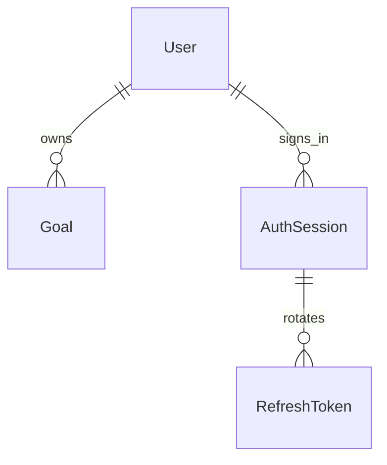

# M2: accounts, sessions and safe goal ownership

Design date: 23 November 2026; registration verified 24 November. Database foundation migration `20261123140042_add_auth_sessions_and_goal_owner` is applied and the client regenerated. Registration is implemented; login/session APIs remain pending. The proposal folder is historical reference; the active schema and migration history are authoritative.

## Scope and confirmed facts

At the initial design checkpoint only Goal existed. The database foundation is now applied and registration is implemented; profile remains static and login/session flow is pending. The owner confirmed on 23 November 2026 that existing goals were created by them and should eventually belong to their verified real account, never the first signup. Legacy IDs were captured privately before migration; verify destination identity before a separate backfill.

Keep our existing Express/Prisma/PostgreSQL stack and use application-managed accounts. Supabase remains the database host; we are not introducing Supabase Auth alongside a competing account system. A managed identity service is a reasonable alternative for other products; implementing the explicitly requested bcrypt/JWT flow serves this project's backend-learning goal.

## Concepts in plain English

- Account: your identity record, including a unique email and password verifier.
- Password hash: a one-way verifier made from a password. We compare a login attempt against it; we do not decrypt it to recover the password.
- Session: one signed-in login, for example your laptop browser. Another device can have its own session.
- Access token: a temporary badge sent in Authorization: Bearer headers for protected API calls.
- Refresh token: a secret renewal pass used to get another access token without entering a password again.
- Authentication: checking who is making a request.
- Authorization: checking whether that person may act on this particular record.
- Foreign key: a database rule saying a reference must point to an existing record.
- Backfill: deliberately filling a newly added field for records that already exist.

## Proposed account and session behavior

1. Registration validates name/email/password, normalizes email for our account-identity policy, hashes the password and inserts a User. Email uniqueness is enforced in the database, including concurrent registration attempts. Return only explicit public fields. Registration does not silently create a login session in the first iteration.
2. Login verifies the password. Unknown email and wrong password use the same public invalid-credentials response. Add dedicated authentication request limits; the existing general limit alone is insufficient.
3. Successful login creates an AuthSession and its first random refresh token, then issues a signed JWT access token. Proposed starting lifetimes are 15 minutes for access and 7 days absolute for the session/refresh chain; test/configure expiry deliberately rather than treating these as universal standards.
4. The browser keeps the access token in memory and sends it in Authorization headers. It does not persist credentials/tokens in localStorage or sessionStorage. On page reload, use the protected refresh-cookie flow to restore a session, not a stored password.
5. Keep the refresh token in an HttpOnly cookie, with Secure in production, SameSite=Lax for the intended same-site deployment and a narrow suitable path. Prefer frontend/API on the same site through routing/subdomains. A truly cross-site deployment needs a separately reviewed cookie/CSRF policy and may face browser cookie restrictions.
6. Refresh validates the cookie token, session and expiry, atomically consumes that token and creates its replacement, then returns a new access token and updates the cookie. Store only hashes of high-entropy random refresh tokens. A replay of a consumed token revokes that session. Client code must coordinate concurrent refreshes to avoid accidentally triggering reuse detection.
7. Every protected request verifies the access JWT signature, fixed algorithm, issuer, audience, expiry, user identifier and session identifier, then checks the session is active and belongs to that user. This deliberate database check makes logout/password-change revocation effective for subsequent requests before a JWT's natural expiry. A request already authorized and in flight may finish.
8. Logout revokes the session and clears the cookie. Password change verifies the current password, updates its hash and revokes all sessions. A user signs in again afterward. Handle session/refresh changes transactionally.

Signed access JWTs are readable, not encrypted secrets. Include only needed identifiers/expiry, never password hashes, private career data or a refresh token. Use a strong server-only signing secret and a library with explicit verification settings. No keys are generated or added in this planning step.

## Password hashing decision

Preserve the owner's requested bcrypt design. Reject passwords above bcrypt's 72-byte UTF-8 input limit rather than silently truncating them; do not trim or lowercase passwords. Benchmark the work factor on the deployment hardware (initial candidate 12; meet at least the OWASP bcrypt minimum of 10). Never return/log the hash. Long random refresh secrets can use a cryptographic hash for lookup because their entropy differs from human-chosen passwords.

OWASP prefers Argon2id for new systems and describes bcrypt primarily for legacy/compatibility contexts. We retain bcrypt as an explicit project requirement. Registration now enforces at least 15 Unicode code points, a 72-byte cap, no password normalization, and rejects NUL/malformed Unicode/whitespace-only values. Cost 12 was locally benchmarked; remeasure on the production host. Do not claim this guarantees strength: comprehensive common/compromised-password screening remains required before unrestricted public launch. No arbitrary character-composition rule was added.

## Cookies and CSRF must be implemented together

HttpOnly prevents ordinary script reads; it does not prevent all XSS effects or stop a browser sending cookies. SameSite and CORS are only parts of the defense. Before enabling browser refresh/login/logout, implement and test a CSRF mechanism (including login), exact trusted-origin checks and correct JSON/header requirements. Use an established mechanism with explicit session/pre-login binding; do not invent an unreviewed token scheme.

The existing CORS middleware currently disables cookie credentials. Enable credentials only for exact approved origins when cookie endpoints are implemented; allow the chosen CSRF header, and use credentials: include in the frontend. Never combine credentialed requests with wildcard origins. Cookie/CSRF endpoint design is a prerequisite for browser auth, not a deferred post-release patch. Mark token responses no-store and avoid placing credentials in URLs or logs.

## Proposed relational structure

Goal ownership is temporarily optional during migration. Intended fields, not final Prisma code:

| Model | Planned fields and rules |
| --- | --- |
| User | Integer id, name, normalized unique email, passwordHash, createdAt, updatedAt |
| AuthSession | Random unique id, required userId foreign key, createdAt, absolute expiresAt, nullable revokedAt; userId index |
| RefreshToken | Random unique id, required sessionId foreign key, unique tokenHash, expiresAt, createdAt, nullable usedAt; sessionId index |
| Goal additions | Nullable userId foreign key initially, userId index; preserve all existing fields, IDs, dates and values |

The session is stable across refreshes. Separate RefreshToken rows retain consumed-token history so reuse can be detected. A stable session ID also lets access tokens reference one revocation record. No token value is stored in plain text. Use explicit restrictive deletion rules initially to prevent accidental deletion of goals/session history; account deletion/retention is a later reviewed operation, not an automatic cascade.

## Safe migration plan

Use three stages: expand -> backfill -> enforce. No reset, table replacement, blanket ownership update or rewritten initial migration.

### A. Expand: add compatible structures

- Check current schema/migration status and aggregate legacy row metadata using existing authorized read-only access. Do not display goal contents or secrets.
- Confirm a usable backup/restore route before applying a remote schema change. The owner can confirm dashboard backup availability if existing tooling cannot establish it; no dashboard credential sharing is needed.
- Prepare an additive migration locally from the known schema/migration history. Review SQL: create User/AuthSession/RefreshToken, add nullable Goal.userId, foreign keys and indexes. Existing goals receive NULL ownership with no default account.
- Use an isolated development/shadow database if tooling needs one; do not point destructive development/shadow operations at the valuable Supabase database. Custom Prisma config flags remain explicit. Do not run migrate reset or db push as a shortcut.
- Review impacts, apply the additive migration as a separate controlled step, then verify row count/IDs, columns, constraints and migration status. Backward-compatible structure does not mean applying DDL has zero locking/operational risk.

### B. Backfill: link confirmed legacy goals

- Implement/register the real owner account and verify its intended email/account ID with the owner. Never infer identity from an ID of 1 or first signup.
- Before introducing new writes, capture the intended legacy ID set or another reviewed deterministic cutoff without logging goal text. If the set is not known, keep records unassigned until it is established.
- In a reviewed transaction, update only that captured set with userId still NULL to the verified owner's ID. Verify matched/changed counts, unchanged non-owner fields and resulting ownership. Refuse unexpected preassigned/missing records; do not claim or overwrite another user's data.
- Do not publish an open claim-legacy endpoint. A privileged one-time backfill is not an ordinary user feature.

### C. Enforce: require ownership

- As soon as authenticated goal writes are introduced, derive userId from verified authentication on the server. Ignore/reject any client attempt to select another owner.
- Make all resource queries/mutations ownership-scoped. NULL-owned legacy goals must be invisible to ordinary users during transition. Review/close direct Supabase Data API access to Goal alongside that rollout so it cannot bypass backend ownership; the newly added credential/session tables already use deny-by-default RLS.
- After all intended rows are assigned and a read-only check proves zero NULL owners, review a second migration that makes userId required. Do not run it while unresolved legacy rows remain.
- Verify anonymous requests are denied and User A cannot read/update/delete User B's goals. Use a safe 404 for inaccessible resource lookups to avoid disclosing another user's record existence.

The additive apply stage is now complete and verified. Backfill and required ownership remain separate future steps after the actual owner account is created and verified.

## Incremental implementation order and API plan

1. Review this design and confirm legacy ownership (owner confirmation received; destination account does not yet exist).
2. Draft the additive schema/migration and verify it in an isolated test environment; establish remote backup readiness before applying.
3. Implement password hashing and real POST /api/users/register with validation, duplicate handling and safe public fields.
4. Implement POST /api/auth/login, refresh, logout and CSRF support, session/refresh rotation/revocation and tests in small increments. Do not expose unfinished cookie auth.
5. Replace static GET /api/users/profile with a protected real-user response; protect goal creation and derive ownership server-side. Include password-change/session-revocation behavior.
6. Backfill confirmed legacy records, enforce required ownership and verify the complete two-user workflow.

Tests must cover duplicate signup races, password hashes omitted from responses/logs, invalid credentials, token tampering/expiry, revoked sessions, refresh rotation/replay/concurrency, cookie flags, CSRF/origin denial, logout, password change and cross-user goal access. Unit/API test doubles do not replace isolated real-database checks for constraints and transactions. Never use ordinary user data for automated mutation tests.

Email verification, recovery, account deletion and further account settings need explicit later milestones before unrestricted public launch. Do not claim this authentication plan alone completes production account security.

## References and status

Recommendations were checked against [OWASP session management](https://cheatsheetseries.owasp.org/cheatsheets/Session_Management_Cheat_Sheet.html), [password storage](https://cheatsheetseries.owasp.org/cheatsheets/Password_Storage_Cheat_Sheet.html), [CSRF prevention](https://cheatsheetseries.owasp.org/cheatsheets/Cross-Site_Request_Forgery_Prevention_Cheat_Sheet.html) and [Prisma expand/contract guidance](https://www.prisma.io/docs/guides/database/data-migration). [RFC 9700 refresh-token protection](https://www.rfc-editor.org/rfc/rfc9700.html#section-4.14) informs rotation/reuse handling; CareerOS is not claiming to implement an OAuth authorization server.

Implementation status: foundation migration applied on 23 November 2026 after a restore-verified application-schema/data backup, native PostgreSQL 17 rehearsal of exact SQL, permission/freshness/drift checks and automated regression tests. SQL is transactional, with a 5-second lock timeout and 30-second statement timeout, and enables RLS without public policies on User/AuthSession/RefreshToken. Post-apply checks confirmed original goal values/history preserved, NULL ownership, empty new tables, matching migration checksum and no model drift. Prisma client generation, build/typecheck, 62 reported tests and read-only compiled-server smoke/shutdown passed. Backup scope excludes roles/privileges/managed services and is local-only; it is not a full-platform recovery certification. Account APIs, session logic, CSRF/browser changes, verified destination account, backfill and required ownership remain pending. Never edit/replay the applied SQL to make subsequent changes; add another reviewed migration.

Registration step: validated name/email/password, asynchronous salted bcrypt, public-only selection/serialization, safe duplicate 409 and dedicated signup throttling are implemented. Default suite reports 72 tests; isolated PostgreSQL integration reports five, including a real concurrent duplicate race. No Supabase account or session was created by verification, and no schema change was needed. Login, refresh/logout, CSRF, protected profile/goals and legacy ownership remain pending.
